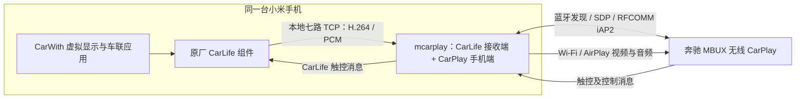

# CarPToCarL 与 mcarplay：奔驰 GLC 的 CarWith → CarLife → CarPlay 方案

## 结论和版本边界

目标已更正为：在同一台小米手机内接收 CarWith 的 **CarLife** 数据，由 mcarplay 扮演无线 CarPlay 手机端，连接 2024 款奔驰 GLC260。无需另加转换盒；本轮不开发 ICCOA、不修改奔驰系统，也不承诺仪表全屏导航或有线 USB CarPlay。

CarPToCarL 的代码与这个方向一致，最值得借鉴的是**在配对前发布能力并保持监听**。但它的“只认苹果设备”开关不能证明已经完整模拟 iPhone，更不能证明奔驰 GLC 已适配。可把它作为有依据的实验方向，不能把它当作现成的奔驰解决方案。

本次审阅固定版本：

| 项目 | 版本/提交 | 用途 |
| --- | --- | --- |
| CarPToCarL | `1.2.51` / `3cbc8e85544bcffcc2aa45f1f3c5e1c70f9ca715` | 参考实现，未把其整个媒体/认证栈移植过来 |
| mcarplay main | `ab0cb93878ced6143d45a775c33e699882421304`，`0.1.6` | 本轮实现的基线 |
| 本地 `mercedes-carlife` | `0.1.7-debug` | 提前公告、可选探针、配对状态门控及回连窗口的测试分支 |

之前的 `carlink` 分支保留，未将其原型混入本轮。当前未得到本轮 APK 的奔驰实车结果。

## 一、代码实际建立的通信链路

这里有两个相互独立的协议端点：手机内部由 mcarplay 接收 CarLife，手机外部由 mcarplay 提供 CarPlay。奔驰只需支持无线 CarPlay，无需支持 CarLife。CarWith 及原厂 CarLife 引擎仍负责生成车联画面；mcarplay 不能仅靠注册蓝牙服务替代它们。

mcarplay 的七路端口是：命令 `7240`、视频 `8240`、媒体 `9240`、TTS `9241`、语音 `9242`、触控 `9340`、数据 `9440`，见 `CarLifeChannelConnector.kt`。`CarLifeSession` 负责入口、认证/seed、通道及视频状态机；`SessionController` 将该源接到 `VideoSender` 和 `CarLifeAudioBridge`。

CarLife 和 CarPlay 的握手、控制报文、密钥及封装分别处理，不能直接把加密 CarLife 报文交给奔驰。视频在格式兼容时可保留 H.264 压缩帧，仅重新封装；无需先解码为图片。mcarplay 已有不兼容情况下的转码回退，音频则有 PCM 重采样/混音及按协商选择 PCM 或 AAC 的路径。因此“不增加视频重编码”是可以争取的常见路径，不是所有分辨率下的保证，也不能据此报一个未经测量的延迟数值。

## 二、“多声明两条服务”到底做了什么

参考代码：[BtIdentityProbe.kt](https://github.com/jjuugk/CarPToCarL/blob/3cbc8e85544bcffcc2aa45f1f3c5e1c70f9ca715/app/src/main/java/io/github/shaonialife/carptocar/bt/BtIdentityProbe.kt)、[BtCompatPrefs.kt](https://github.com/jjuugk/CarPToCarL/blob/3cbc8e85544bcffcc2aa45f1f3c5e1c70f9ca715/app/src/main/java/io/github/shaonialife/carptocar/bt/BtCompatPrefs.kt)、[Iap2BluetoothServer.kt](https://github.com/jjuugk/CarPToCarL/blob/3cbc8e85544bcffcc2aa45f1f3c5e1c70f9ca715/app/src/main/java/io/github/shaonialife/carptocar/bt/Iap2BluetoothServer.kt)。

| UUID | CarPToCarL 的行为 | mcarplay 原 main | 本轮测试分支 |
| --- | --- | --- | --- |
| `00000000-deca-fade-deca-deafdecacafe` | 真正的手机侧 iAP2 RFCOMM 协议处理 | 已有 | 保留完整处理 |
| `2d8d2466-e14d-451c-88bc-7301abea291a` | `CarPlay` 占位记录；连入即关闭 | **已经有同一记录** | 保留，不重复注册 |
| `02030302-1d19-415f-86f2-22a2106a0a77` | `Wireless iAP v2` 占位记录；连入即关闭 | 没有 | 由实验开关启用，单独计数 |

所以参考项目相对自己的基本监听器增加了两条，而相对 mcarplay 只多了一条 UUID。服务名与 UUID 只是发现信息。源码没有通过这两条占位记录交换 iAP2 数据、做身份认证或提供视频。

这可能有用的情形是：车机以某些 UUID 作为提供 CarPlay 入口的初筛条件。若奔驰在配对阶段只检查这些信息，提前发布可能改变按钮是否出现。若奔驰还检查 EIR 内容、设备类别、厂商数据、配对行为或后续协议，则仅补 UUID 仍可能失败。我们尚无这辆 GLC 的 HCI 抓包，不能指定其中哪项就是拒绝原因。

Android 普通应用调用 `listenUsingRfcommWithServiceRecord` 可以注册 SDP 服务；不能由此宣称已经任意改写原始 EIR、苹果厂商标识、蓝牙控制器或整套 iPhone 行为。系统是否把 UUID 放入发现响应、以及奔驰是否检查它，仍需抓包确认。

还有一个重要边界：**如果车机真正选择 `02030302…` 来承载 iAP2，当前探针会主动关闭连接，仍然无法完成会话。** 此时下一步是观察该通道的实际负载、建立适配测试，再评估把它接入现有 iAP2 处理器；不能只看注册成功就宣布完成。

## 三、比 UUID 更重要的发布时机和生命周期

CarPToCarL 的 `SessionController.ensure()` 会按默认开启的 `BtCompatPrefs` 调用 `applyBtCompat(true)`。它在用户点击正式连接之前就挂起服务，用 `idleListening` 区分公告与正式会话，并有周期检查补挂服务。手动停止使用 `compatSuppressed` 抑制恢复。

这个差异与本车现象有关：如果奔驰在初次配对时缓存“只有电话/音乐能力”，后来打开 App 注册服务，不保证它马上重新查询并显示按钮。正确的对照实验应当在打开 App、确认公告后再进行一次全新配对。

参考实现也有需要谨慎处理的地方：`BtIdentityProbeSockets.start()` 先启动 accept 线程，循环依赖的 `running` 却在循环注册之后才置为 true，存在工作线程提前退出的竞态风险。它不能证明奔驰问题由此产生，但不适合直接照搬。本轮继续使用 mcarplay 的 `PhoneSdpListener`：先发布当前记录对象，再启动线程；关闭、旧回调和恢复令牌沿用其代际隔离。

本轮用 `connectedDevice` 前台服务持有提前公告，通知明确显示“尚未建立 CarPlay”，提供停止入口。提前公告不持有媒体 CPU 唤醒锁、不自动启动 CarWith。权限和当前免责声明接受状态仍需满足。蓝牙关闭后撤销记录，重新开启时只恢复仍请求的公告；用户停止后不自动复活。

这不是开机即全自动接管：需要用户至少打开应用、授权，后台存活也受 HyperOS 限制。已配对手机的自动连接继续沿用原项目开关。

## 四、结合用户奔驰日志的实际修复依据

已知设备信息：用户称小米 14 / HyperOS OS3.0，日志型号为 `24129PN74C`、Android 16/API 36，CarWith `4.0.9-20260629 (104000009)`、小米 CarLife `8.6.6 (258)`；2024 款 GLC260，用户确认同车 iPhone 无线 CarPlay 可用。未提供 MBUX 固件号。型号字符串按日志保留，不据此推断零售机型。

原日志能够证明：

- 本机 iAP2/CarPlay SDP 注册成功；**这只能证明本机注册**。
- 首轮监听回连仅保留数秒，ACL 断开后会自动停止、撤销服务，回连机会较短。
- 后续一轮从 `BONDED → BONDING` 后仍尝试 RFCOMM，在约 `158ms` 的 `READ_FAILED` 后转为等待车机主动连接，最终 `BONDING → NONE`。
- 没有真正成功的 iAP2 RFCOMM 或接收端回连，未进入可归因于视频、音频或 CarWith 内容的阶段。

本轮据此修改：

1. **提前公告实验开关，默认开。** 普通打开 App、完成声明和蓝牙授权后发布；关闭可回到原来的两条记录和随连接启动的发布时机。运行中的正式连接不因设置切换被拆除，额外记录在下一次重新注册时调整。
2. **配对状态门控。** SDP 后及创建 RFCOMM 前重新检查仍为 `BONDED`；配对中不尝试主动连接、不干预音频配置文件。连接失败时若配对已变化，不再把快速失败计作“仅能回连”的依据。
3. **有界回连窗口。** 兼容模式下，正式连接尚未建立 AirPlay 客户端时，ACL 暂断保留最多 60 秒窗口；重复断开不延长同一窗口。明确重连/重新开始及用户停止使旧超时任务失效。原有 Wi-Fi 媒体交接保留策略优先。
4. **诊断分开计数。** 新增服务注册/监听及 `wirelessProbeConnections`；探针接触属于 `CAPABILITY_ONLY`，不能当作 `ACCEPTED_IAP2`。提前公告提升为正式会话时保留实际监听状态，避免日志误写成“未注册”。

`ec884348…` 在旧策略中用于减少进入回连等待所需的快速失败次数，不是奔驰独有标识，也不是“误把奔驰识别成奇瑞”的充分证据。本轮修正提示的断言语气，不新增未经验证的“奔驰专属 UUID/认证策略”。

## 五、CarLife 源端仍需单独验证

参考代码：[CarLifeHijack.kt](https://github.com/jjuugk/CarPToCarL/blob/3cbc8e85544bcffcc2aa45f1f3c5e1c70f9ca715/app/src/main/java/io/github/shaonialife/carptocar/carlife/CarLifeHijack.kt)。`prewarm()` 是等候本机 `7240` 的线程，不等于自动启动原厂车联。文档/代码主要依据荣耀 CarLife `8.8.5`，不能直接当成用户小米组件版本的验证。

mcarplay 已针对小米实现 `CarlifeAdbActivity` 等公开入口和本地七路接收；组件名称含 Adb 不等于必须用电脑 ADB。`CarLifeLauncher.EntryLaunchResult.REQUESTED` 只表示发起 Activity 请求，**不能证明原厂页面实际启动、虚拟显示建成或已收到真实 CarWith 画面**。HyperOS 后台弹出限制可能静默拦截，需要依据日志逐层判断。

最低源端通过条件应包含：七路全部连通、认证/seed/渠道准入完成、视频初始化完成、持续收到有效 H.264 且画面内容随 CarWith 操作变化。只收到端口响应、欢迎页或应用自身的自测数据均不算通过。音频和触控还需独立观察。

正式连接还需保持 iAP2 与 `_carplay-ctrl._tcp` 中的本机蓝牙地址一致。基线代码提供 Shizuku 读取或手动填写真实地址的方式；不能把 `02:00:00:00:00:00` 占位地址当成成功。补 SDP 无法解决这个后续问题。

## 六、未直接搬入的参考功能

| 参考功能 | 为什么本轮不直接移植 |
| --- | --- |
| 每 1.5 秒断开音频配置文件、最多 5 分钟的 guard | 可能干扰电话/音乐及 ACL；用户当前尚无足够证据需要持续拆链。保留 mcarplay 已有受控对照策略 |
| 不同厂商的 `0x4300` 双标识、重认证、反复唤醒策略 | 主要解决真实 iAP2 已建立之后的问题；用户日志尚未到该层，不能把其他厂商策略套在奔驰上 |
| 更激进的屏幕缓冲/ACK、音频时钟/格式实验 | 需要先连接和测量；可能同时改变多个变量，妨碍定位蓝牙发现问题 |
| NowPlaying、封面、歌词等扩展 | 可作为连接成功后的后续增强，不影响当前入口缺失的首要判断 |
| 荣耀自动入口或其尺寸假设 | 小米 CarWith 的入口、权限、虚拟显示行为不同；沿用已针对小米实现的源端 |

关于“奔驰已兼容”的外部证据：[Issue #6](https://github.com/jjuugk/CarPToCarL/issues/6) 仍为 open。讨论中有“只能用作蓝牙”、`1.2.30` 配对失败及作者建议试 `1.2.41`，没有该讨论用户确认成功的回复，也未确认是 GLC260。它不能证明 `1.2.51` 一定失败；同样不能用 README 的广泛支持描述证明本车成功。

## 七、连接成功后值得比较的媒体路径

两项目都有 H.264 直接转发、参数集/关键帧处理及触控回传；这些机制不负责生成奔驰的初始 CarPlay 按钮。连接后再按下列顺序测量，避免把其他车机的优化直接当作 GLC 的最佳配置：

- **画布与码流尺寸。** 对照奔驰协商尺寸、CarWith SPS 尺寸及 VideoConfig，确认是直接转发还是已触发转码。声明高分辨率不会把低分辨率画面变清楚。参考项目既有协商画布，也有独立 SPS/触控尺寸，不能只复制其中一个宽高字段。
- **队列和拥塞。** mcarplay 的外部视频队列容量是 64 帧，已在满队列时记录丢帧并由源端门控等待关键帧。若真的积压，可能产生明显尾延迟；容量不是固定延迟。后续可研究更及时地淘汰旧 GOP，但必须保持参考帧完整性，不能随意删 P 帧。先看现有队列深度、写 socket 耗时和丢帧统计。
- **声音。** mcarplay 已按 MEDIA/TTS/VOICE 解析，做重采样和导航压低音乐。按车机协商选择 PCM/AAC；PCM 的 352 采样和 AAC 的 1024 采样是封包/编码颗粒，不能当作端到端延迟。比较导航播报起点、音乐连续性及长时间音画漂移。
- **触控。** 分开核实车机触点、CarLife 坐标及实际 UI 命中位置；拖动/缩放也需验证。原有触摸通路与方向盘/旋钮键并不等价，后者需要看到车机真实上报和对应源端支持，不能凭有 HID 模块就承诺所有按键可用。

本轮不填写“延迟低于某毫秒”或“原厂同等清晰度”。可信的对比需要同一车辆/手机/地图场景，记录是否转码、分辨率/帧率、温度和持续时间，并用实际屏幕/声音变化测量。

## 八、这次 APK 的实车验证顺序

1. 安装 `0.1.7-debug`。包名仍为 `com.mcarplay.app`；若现有安装包是不同签名的 release，Android 不允许直接覆盖。保留现有日志后，可以使用原签名构建本分支，或卸载旧包再装（会清除旧设置）。本轮不持有或更换原发布签名。
2. 打开 mcarplay，接受声明、授予蓝牙权限。在「车机显示」确认“配对前发布 CarPlay 能力（实验）”开启。观察 `BT-DISCOVERY` 及三项 `SDP_REGISTER outcome=OK`、`LISTENER listening=true`。**这一步还没有证明奔驰读取了服务。**
3. 为排除旧能力缓存，在奔驰和手机上只删除彼此的旧配对，然后重新配对。测试时暂不让其他手机占用车机 CarPlay。手机保持系统蓝牙设置页可发现；本实验不自动强制可发现状态，`isDiscovering=true` 也只代表手机在扫描其他设备。
4. 从奔驰的智能手机集成/添加设备流程选择手机，观察“Apple CarPlay”是否由“—”变成可用。若可用就选择它；记录出现时点和提示。无需寻找这台 MBUX 上不存在的独立 CarPlay 按钮。
5. 建立 iAP2 后再看热点凭据/端点、Wi-Fi、ctrl 邀请及 AirPlay 的配对/SETUP/RECORD。按原项目要求处理 WLAN/本机地址和后台权限。再确认本机 CarWith 实际画面、声音和触摸回传。
6. 每轮固定操作后至少留出约 70 秒，以覆盖 60 秒断链观察窗，再导出诊断。记录开关、是否重新配对、车机界面及版本；失败后不要连续改变多项参数。

| 最远证据 | 能说明什么 | 下一步 |
| --- | --- | --- |
| 仅本机三个 UUID 注册成功 | App 已请求服务，尚无奔驰发现证据 | 看车机入口及 HCI 中发现/SDP 流程 |
| `wirelessProbeConnections > 0`，只有 `CAPABILITY_ONLY` | 有设备接触新增服务；不能视作 iAP2 成功 | 核对目标来源及该服务后续协议负载 |
| 正确目标 `ACCEPTED_IAP2` / 出站 RFCOMM 成功 | 进入真实字节流，但不保证协议握手通过 | 看 iAP2 同步、识别/认证及消息交互 |
| Wi-Fi/AirPlay 到 RECORD，画面为空 | 蓝牙入口已不是最早阻塞层 | 看 CarWith 源、SPS/PPS/IDR、画布和主屏归属 |
| 画面正常但音乐/触控异常 | 通信链路基本建立 | 分别分析音频与 CarLife 触控 |

若始终没有入口，需要比较同车 iPhone 成功和 Android 失败的 Bluetooth HCI 抓包，重点是奔驰是否查询手机 SDP、看到了哪些 UUID、是否尝试对应 RFCOMM channel，以及配对被谁以何种原因中断。手机向奔驰发起的 `SDP_QUERY` 不等于奔驰查询过手机。应用日志无法替代这个方向性证据。

## 九、验证记录

实现包含新增的 SDP 回滚/三记录释放、探针与协议连接分离、公告提升的诊断状态保留、重新配对失败不误判以及回连窗口代际测试。完整门禁通过：standard 909 项、remote bridge 24 项，均 0 失败/错误/跳过；Spotless、standard lint、standard debug APK 构建通过。APK 签名校验通过，包名 `com.mcarplay.app`、versionCode `1070000`。结果同步记录于 `IMPLEMENTATION_PLAN.md`。单元测试、lint 和 APK 构建都不等于奔驰实车兼容；连接时延、持续功耗、清晰度和声音同步需要本轮实测。
